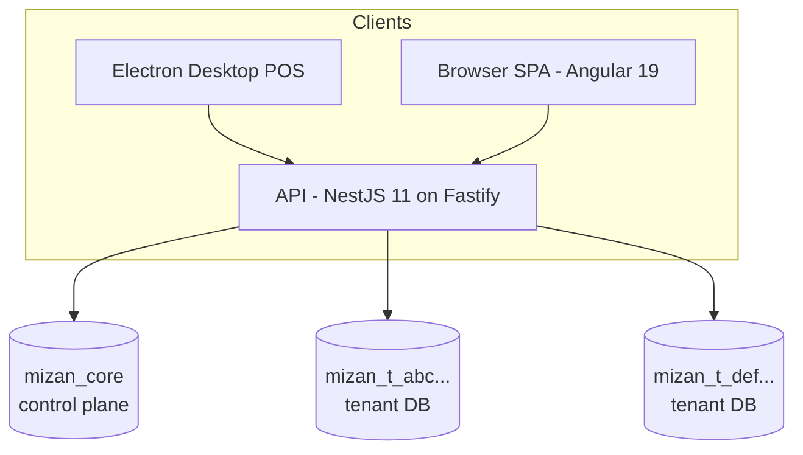

# Architecture

## Overview

- **Frontend**: Angular 19 SPA. Offline POS queue in IndexedDB (Dexie). Packaged for
  desktop via Electron (no PWA).
- **Backend**: NestJS 11 on the Fastify adapter. Stateless; all state in MongoDB.
- **Data**: one MongoDB deployment; `mizan_core` control-plane DB plus one database per
  tenant, all multiplexed over a single pooled connection (`useDb`).

## Backend module map

| Module | Responsibility |
| --- | --- |
| `config` | zod-validated environment, typed config service, production fail-safes |
| `database` | root connection, core/tenant model registration, tenant handle cache |
| `auth` | platform/tenant login, JWT access+refresh rotation, guards (JWT → permissions → entitlements) |
| `tenants` | registration, resumable provisioning pipeline, suspend/reactivate |
| `subscriptions` | module registry, plan seeding, entitlement resolution + cache |
| `catalog` | products, categories, POS lookup |
| `inventory` | idempotent stock movements, levels, adjustments |
| `sales` | checkout, offline sync, refunds, cashier sessions |
| `customers` / `suppliers` / `purchasing` | master data + purchase orders / goods receipt |
| `reporting` | aggregation-based reports |
| `org` | branches, users, audit log |
| `audit` | fire-and-forget audit event recorder |
| `health` | liveness/readiness (outside the `api/v1` prefix) |

## Request pipeline

1. Fastify + helmet, CORS from config, 2 MB body limit, correlation-id aware pino logger.
2. Global `ValidationPipe` (whitelist, forbid unknown, transform).
3. Global guard order: **Throttler → JwtAuthGuard → PermissionsGuard → EntitlementsGuard**.
   - JwtAuthGuard verifies the access token and attaches `req.authUser`
     (scope, tenantId, roles, computed permissions).
   - PermissionsGuard enforces `@PlatformOnly` / `@RequirePermissions`; platform admins
     have **no implicit access** to tenant data endpoints.
   - EntitlementsGuard enforces `@RequireModules` against the tenant's subscription.
4. Controllers resolve tenant models through `TenantAccessService`, which re-checks the
   tenant's status (30 s cache) and throws 403 for suspended tenants.

## Future verticals

Restaurant/Retail/Pharmacy are first-class entries in the module registry marked
unimplemented. `validateModuleSet` rejects any plan that references them, so they are
visible in the catalog design but cannot be activated until their features ship. Adding a
vertical means: implement its module(s), flip the registry flag, create plans — no changes
to tenancy, auth, or entitlements plumbing.

## Key design decisions

See [adr/](adr/) for the decision log. Highlights:

- Database-per-tenant over shared collections (ADR-0001).
- Integer minor units for money; milli-units for quantity (ADR-0002).
- Idempotency keys instead of multi-document transactions (ADR-0003).
- Electron instead of PWA for the offline POS (ADR-0004).
