# Mizan — Full Data Model & Flow Documentation (Study Guide)

This is the deep technical reference for the whole platform: every collection, every field, how collections connect (ER diagrams), and exactly which documents change when each business action happens.

> MongoDB has no foreign keys. All relationships below are **soft references** (a string field holding another document's `_id` or a business key like `tenantId`/`planId`). Integrity is enforced in the service layer, not by the database.

---

## 1. Big Picture

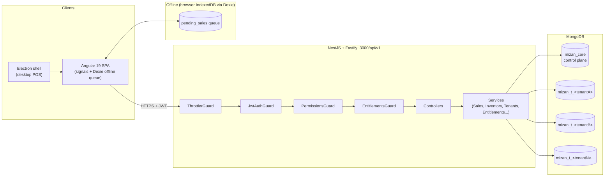

**Isolation model: database-per-tenant.** The control plane (`mizan_core`) knows *who* tenants are and *what* they are entitled to. Each tenant's business data lives in its own physical database `mizan_t_<tenantId>` (16-hex-char id). A request's JWT carries `tenantId`; `TenantAccessService.modelsFor(tenantId)` resolves the connection to that one database — code can never accidentally query another tenant's data.

---

## 2. Control Plane — `mizan_core` ER Diagram

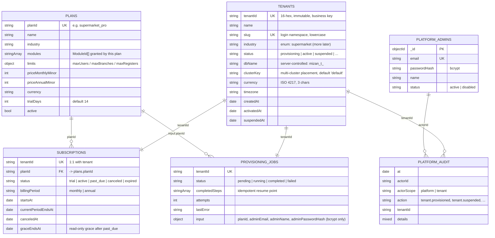

### Key invariants (core)
- `tenants.dbName` is **always server-generated** from `tenantId` — never from user input (prevents injection into DB naming).
- `subscriptions` is strictly 1:1 with tenants (unique index on `tenantId`).
- `provisioning_jobs.completedSteps` makes provisioning **resumable**: a retry skips finished steps.
- Plaintext passwords are never persisted anywhere — `provisioning_jobs.input.adminPasswordHash` is already bcrypt.

---

## 3. Tenant Database — `mizan_t_<tenantId>` ER Diagram

```mermaid
erDiagram
    USERS ||--o{ SALES : "cashierId"
    USERS ||--o{ STOCK_MOVEMENTS : "createdBy"
    USERS ||--o{ PURCHASE_ORDERS : "createdBy"
    USERS ||--o{ AUDIT_EVENTS : "actorId"
    USERS ||--o{ CASHIER_SESSIONS : "cashierId"
    BRANCHES ||--o{ SALES : "branchId"
    BRANCHES ||--o{ STOCK_LEVELS : "branchId"
    BRANCHES ||--o{ STOCK_MOVEMENTS : "branchId"
    BRANCHES ||--o{ PURCHASE_ORDERS : "branchId"
    BRANCHES ||--o{ CASHIER_SESSIONS : "branchId"
    CATEGORIES ||--o{ PRODUCTS : "categoryId"
    CATEGORIES ||--o{ CATEGORIES : "parentId (tree)"
    PRODUCTS ||--o{ STOCK_LEVELS : "productId"
    PRODUCTS ||--o{ STOCK_MOVEMENTS : "productId"
    PRODUCTS ||--o{ SALE_LINES : "productId (embedded in sales)"
    PRODUCTS ||--o{ PO_LINES : "productId (embedded in POs)"
    CUSTOMERS ||--o{ SALES : "customerId (optional)"
    SUPPLIERS ||--o{ PURCHASE_ORDERS : "supplierId"
    SALES ||--o{ SALES : "refundOfSaleId (refund doc -> original)"
    SALES ||--o{ STOCK_MOVEMENTS : "refId (type=sale|refund)"
    PURCHASE_ORDERS ||--o{ STOCK_MOVEMENTS : "refId (type=receipt)"
    COUNTERS ||..o{ SALES : "generates saleNumber"
    COUNTERS ||..o{ PURCHASE_ORDERS : "generates poNumber"

    USERS {
        objectId _id PK
        string email UK
        string passwordHash "bcrypt"
        string name
        stringArray roles "owner | manager | cashier | stock_keeper | accountant"
        stringArray branchIds "branch scoping (empty = all)"
        string status "active | disabled"
        stringArray refreshTokenIds "hashed rotation ids, bounded"
        int failedLoginAttempts
        date lockedUntil "brute-force lockout"
    }

    BRANCHES {
        objectId _id PK
        string name
        string code UK
        string address
        bool active
    }

    CATEGORIES {
        objectId _id PK
        string name "unique with parentId"
        string parentId "null = root"
        int sortOrder
        bool active
    }

    PRODUCTS {
        objectId _id PK
        string sku UK
        stringArray barcodes "EAN/UPC/PLU, indexed"
        string name "text-indexed for search"
        string categoryId
        string kind "standard | weighted"
        string unit "pc, kg, ..."
        int priceMinor "sell price, integer minor units"
        int costMinor
        int taxRateBps "0..10000 basis points"
        bool trackInventory
        bool batchTracking
        int reorderLevelMilli "low-stock threshold"
        string status "active | archived (never hard-deleted)"
        int version "bumped on price-relevant updates"
    }

    STOCK_LEVELS {
        string productId "UK with branchId"
        string branchId
        int qtyMilli "materialized balance; MAY go negative (offline)"
        date updatedAt
    }

    STOCK_MOVEMENTS {
        objectId _id PK
        string productId
        string branchId
        int qtyMilli "SIGNED delta"
        string type "sale | refund | receipt | adjustment | transfer_in | transfer_out | waste"
        string refType "sale | refund | purchase_order | ..."
        string refId "source document id"
        string idempotencyKey "UK sparse - replay protection"
        string batchNumber "from goods receipt"
        date expiryDate
        string note
        string createdBy
        date at
    }

    CUSTOMERS {
        objectId _id PK
        string name "text-indexed"
        string phone "sparse index"
        string email
        string address
        string status "active | archived"
        string notes
    }

    SUPPLIERS {
        objectId _id PK
        string name UK
        string contactName
        string phone
        string email
        string address
        string status "active | archived"
    }

    PURCHASE_ORDERS {
        objectId _id PK
        string poNumber UK "PO-000001"
        string supplierId
        string branchId "delivery branch"
        string status "draft | ordered | partially_received | received | canceled"
        array lines "embedded poLine[]"
        int totalMinor
        string note
        string createdBy
    }

    PO_LINES {
        string productId
        string sku "snapshot"
        string description "snapshot of product name"
        int qtyMilli "ordered"
        int unitCostMinor
        int receivedQtyMilli "accumulates per receipt"
    }

    SALES {
        objectId _id PK
        string saleNumber UK "S-00000001 / RF-00000001"
        string clientTxId UK "IDEMPOTENCY KEY (offline + retry safety)"
        string branchId
        string registerId "default 'default'"
        string cashierId
        string customerId "nullable"
        array lines "embedded saleLine[]"
        array payments "embedded payment[]"
        int subtotalMinor
        int discountMinor
        int taxMinor
        int totalMinor "NEGATIVE on refund documents"
        int paidMinor
        int changeMinor
        string status "completed | voided | refunded | partially_refunded"
        string refundOfSaleId "set => this doc IS a refund"
        bool offline "captured offline, synced later"
        date occurredAt "device wall-clock"
        stringArray syncWarnings "price drift, negative stock, clock skew"
        string note
    }

    SALE_LINES {
        string productId
        string sku "snapshot at time of sale"
        string description "snapshot"
        int qtyMilli "milli-units: 1 pc = 1000; 1.5 kg = 1500"
        int unitPriceMinor "snapshot"
        int discountMinor
        int taxRateBps "snapshot"
        int grossMinor "qty x price (rounded half-up)"
        int netMinor "gross - discount"
        int taxMinor "net x rate"
        int totalMinor "net + tax"
    }

    CASHIER_SESSIONS {
        objectId _id PK
        string cashierId
        string branchId
        string registerId
        date openedAt
        date closedAt
        int openingFloatMinor
        int countedCashMinor "entered at close"
        int expectedCashMinor "float + cash sales - cash refunds"
        int varianceMinor "counted - expected"
        string status "open | closed"
    }

    COUNTERS {
        string key UK "sale:<branchId> | refund:<branchId> | po"
        int seq "atomic $inc"
    }

    AUDIT_EVENTS {
        date at
        string actorId
        string action "product.created, sale.refunded, user.updated, ..."
        string entityType
        string entityId
        mixed details
    }
```

### Design principles baked into this schema

| Principle | Where you see it |
|---|---|
| **Money = integers** | Every `*Minor` field is integer minor units (cents/fils). No floats anywhere. Rounding is half-up via bigint math (libs/shared/src/money.ts). |
| **Quantity = milli-units** | Every `*Milli` field: 1 piece = 1000, 1.5 kg = 1500. Lets weighted items share one integer representation. |
| **Snapshot, don't join** | Sale lines and PO lines embed `sku`, `description`, `unitPriceMinor`, `taxRateBps` *as they were at transaction time*. Later price/name changes never rewrite history. |
| **Ledger + materialized balance** | `stock_movements` is the append-only truth; `stock_levels` is just the running balance (`$inc`), unique per (product, branch). You can always rebuild levels from movements. |
| **Idempotency everywhere** | `sales.clientTxId` (unique), `stock_movements.idempotencyKey` (unique sparse), provisioning `completedSteps`. Safe to retry anything. |
| **Soft delete only** | Products/customers/suppliers get `status: 'archived'`; users get `status: 'disabled'`; tenants get `suspended`. Nothing referenced by history is ever hard-deleted. |
| **Refund = new document** | A refund is a new `sales` doc with negative totals and `refundOfSaleId` set. The original is never mutated except its `status`. |

---

## 4. Action → Effect Matrix (what changes when)

This is the heart of understanding the system: every business action and the exact writes it causes.

### 4.1 Tenant registration — `POST /tenants/register`

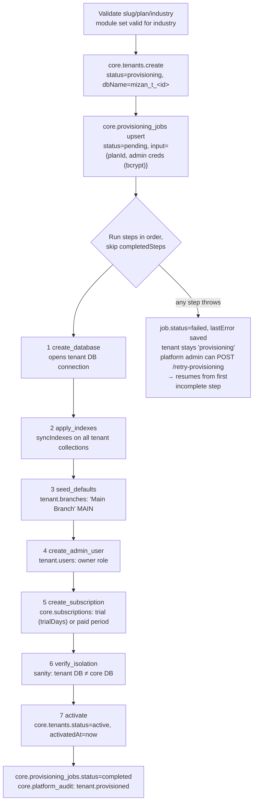

| Collection | Effect |
|---|---|
| `core.tenants` | created (`provisioning`) → `active` + `activatedAt` on success |
| `core.provisioning_jobs` | created; `completedSteps` grows step-by-step; `attempts` +1 per run |
| `core.subscriptions` | created 1:1 (status `trial` if plan has trialDays, else `active`) |
| `tenant.branches` | 1 seeded branch (`Main Branch`/`MAIN`) |
| `tenant.users` | 1 owner user (bcrypt hash) |
| `core.platform_audit` | `tenant.provisioned` or `tenant.provisioning_failed` |

### 4.2 Login — `POST /auth/login` (tenant) / `POST /auth/platform/login`

| Condition | Effect |
|---|---|
| Tenant not `active` | 403 — suspension blocks login itself |
| Wrong password | `users.failedLoginAttempts` +1; lockout sets `lockedUntil` |
| Success | counters reset; a hashed refresh-token id is pushed to `users.refreshTokenIds` (bounded list → oldest rotations drop off); returns access JWT (~15 min) + refresh token |
| `POST /auth/refresh` | validates + **rotates**: old id removed, new id appended (stolen-token replay fails) |
| `POST /auth/logout` | removes the refresh id |

JWT payload carries: `userId`, `tenantId`, `scope` (`tenant`/`platform`), `roles`. Every subsequent request flows through the guard chain: Throttler → JwtAuth → Permissions (role → permission map) → Entitlements (module enabled for this tenant's plan?).

### 4.3 Online checkout — `POST /sales/checkout`

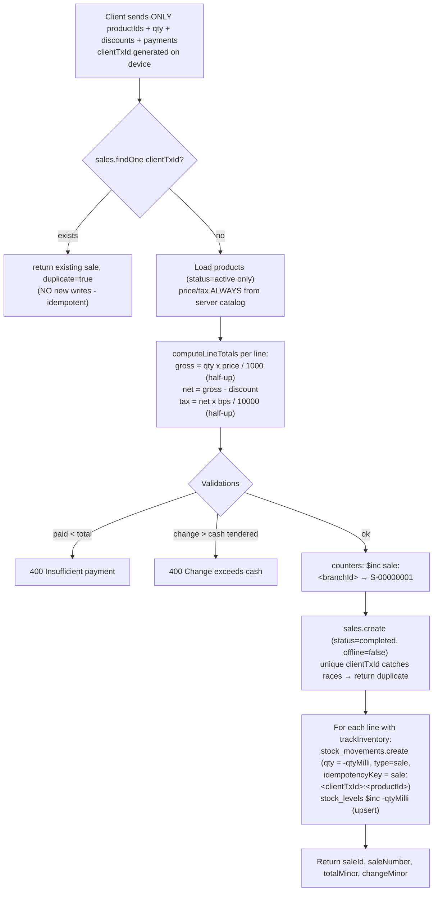

| Collection | Effect |
|---|---|
| `sales` | +1 doc, `status=completed`, lines snapshot server prices |
| `counters` | `sale:<branchId>` seq +1 |
| `stock_movements` | +1 per tracked line, negative delta, idempotency-keyed |
| `stock_levels` | `qtyMilli` decreases per (product, branch); `updatedAt` bumped |

### 4.4 Offline sale → sync — `POST /sales/sync`

The POS enqueues sales in Dexie (IndexedDB) when offline. On reconnect it submits the queue.

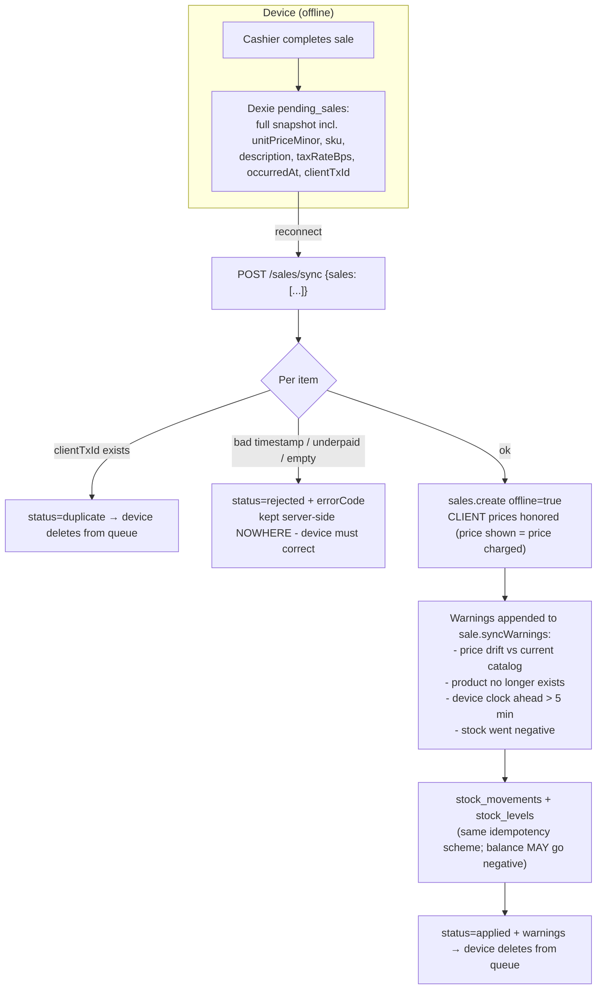

Key policy differences vs online checkout:

| Aspect | Online | Offline sync |
|---|---|---|
| Price source | Server catalog (authoritative) | **Client snapshot honored**; drift logged as warning |
| Stock | Decrements, warns if negative | Decrements, **allowed negative**, warning recorded |
| `occurredAt` | Server time | Device time (skew ≥ 5 min → warning) |
| Archived/missing product | 400 rejection | Accepted with warning (sale already happened in real life) |

### 4.5 Refund — `POST /sales/:id/refund`

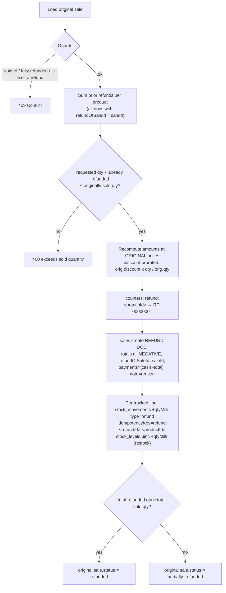

| Collection | Effect |
|---|---|
| `sales` | +1 refund doc (negative money); original doc: **only `status` mutates** |
| `counters` | `refund:<branchId>` +1 |
| `stock_movements` / `stock_levels` | positive delta per line (restock) |

### 4.6 Purchasing lifecycle

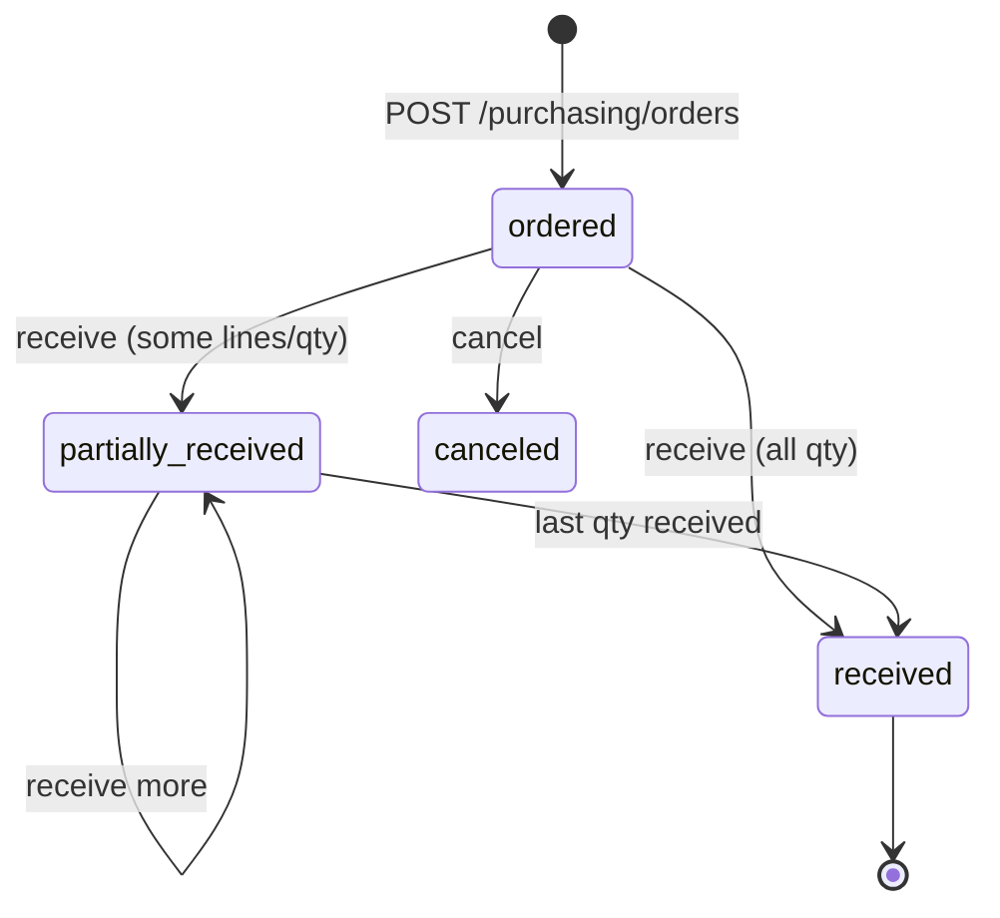

**Create PO** (`POST /purchasing/orders`): validates supplier is `active`, snapshots product `sku`/`name` into lines, `totalMinor = Σ qty×cost`, `counters.po` +1 → `PO-000001`, status starts at `ordered`, audit event `purchase_order.created`.

**Goods receipt** (`POST /purchasing/orders/:id/receive`):

| Check / Effect | Detail |
|---|---|
| Guard | 409 if PO `canceled`/`received`; 400 if line not on PO or over-receiving (`receivedQtyMilli + qty > ordered qty`) |
| `purchase_orders.lines[].receivedQtyMilli` | += received qty per line |
| `purchase_orders.status` | all lines full → `received`, else `partially_received` |
| `stock_movements` | +1 per line: positive delta, `type=receipt`, `refId=poId`, carries `batchNumber`/`expiryDate` (this is where batch/expiry live — per receipt line, not on the product) |
| `stock_levels` | `qtyMilli` += per (product, **PO's branchId**) |
| `audit_events` | `purchase_order.received` |

### 4.7 Stock adjustment / waste — `POST /inventory/adjustments`

One call → one signed movement (`type = adjustment | waste`, note optional) → `stock_levels` `$inc`. Used for stock counts, damage, shrinkage. Response returns the new balance.

### 4.8 Catalog / customers / suppliers / org mutations

| Action | Writes |
|---|---|
| Create/update product | `products` (+`version` bump); `audit_events` |
| "Delete" product | `products.status='archived'` only — historical sales keep their snapshots |
| Create branch | `branches` — **blocked by plan limit** `maxBranches` (EntitlementsGuard/plan limits) |
| Create user | `users` — blocked by `maxUsers`; roles map to permissions |
| Disable user | `users.status='disabled'` → login rejected, refresh rotation dies |
| Suspend tenant (platform) | `core.tenants.status='suspended'` + `suspendedAt`; **every** API call and login for that tenant is rejected at guard level; data untouched |
| Subscription expires | `entitlements` resolves to **empty module set** (30 s cache) → module-gated endpoints 403; data never deleted; `past_due` + `graceEndsAt` in future keeps modules alive (grace window) |

---

## 5. Request Pipeline (every API call)

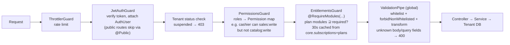

Role → permission examples (libs/shared/src/security.ts): `owner` = everything; `manager` = catalog/inventory/purchasing/sales/reports; `cashier` = sales write + catalog read; `stock_keeper` = inventory + purchasing; `accountant` = reports + read access.

---

## 6. Numbering, Idempotency & Money — the fine print

**Counters** (per tenant DB): atomic `findOneAndUpdate {$inc: {seq: 1}}` on keyed docs — `sale:<branchId>` → `S-00000001…`, `refund:<branchId>` → `RF-…`, `po` → `PO-000001`. Gap-free within a branch, race-safe.

**Idempotency keys:**

| Key | Protects |
|---|---|
| `sales.clientTxId` (unique) | double-submits of checkout & offline sync replays — second attempt returns the original sale as `duplicate` |
| `stock_movements.idempotencyKey` = `sale:<clientTxId>:<productId>` / `refund:<refundId>:<productId>` / `receipt:<poId>:…` | stock being decremented/incremented twice if a request is retried after a partial failure |
| `provisioning_jobs.completedSteps` | re-running provisioning repeating finished steps |

**Money math** (libs/shared/src/money.ts): all derived amounts computed with `bigint` then rounded **half-up** once per derived value:
- `grossMinor = round(qtyMilli × unitPriceMinor / 1000)`
- `netMinor = grossMinor − discountMinor`
- `taxMinor = round(netMinor × taxRateBps / 10000)`
- `totalMinor = netMinor + taxMinor`; sale totals are plain sums of line values (so lines always add up to the total — no reconciliation drift).

---

## 7. End-to-End Master Flow

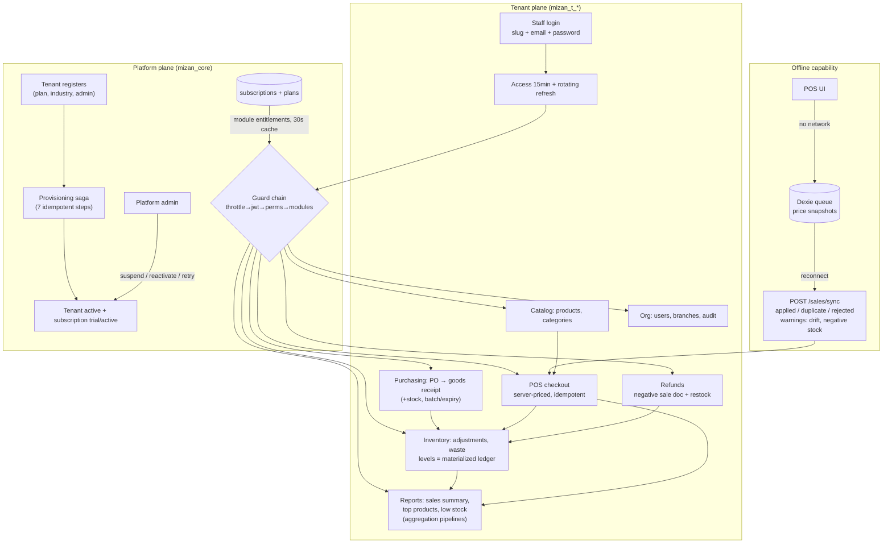

### Data-flow summary of one supermarket day

1. **Morning** — stock keeper receives yesterday's PO: `purchase_orders.lines[].receivedQtyMilli` fill up, `stock_movements(+receipt)` append, `stock_levels` rise, PO flips to `received`.
2. **Daytime** — cashiers check out customers: each sale appends a `sales` doc (price snapshots), a counter tick, and negative `sale` movements; levels fall in real time.
3. **Network drops** — POS keeps selling from Dexie-cached catalog; sales pile up in IndexedDB with device timestamps.
4. **Reconnect** — queue syncs; duplicates are absorbed by `clientTxId`; price drift and negative stock become `syncWarnings` for the manager, never blockers.
5. **A return** — refund doc with negative totals references the original via `refundOfSaleId`; items restock; original flips to `partially_refunded`.
6. **Evening** — reports aggregate `sales` (excluding `voided`, separating `refundOfSaleId` docs) by day/product; `low-stock` joins `products.reorderLevelMilli` against summed `stock_levels`.
7. **Anytime** — every mutation also appended a row in `audit_events` (tenant) or `platform_audit` (core); nothing was ever hard-deleted.

---

## 8. Visual Walkthroughs — step-by-step sequence & state diagrams

These diagrams show the *same* flows as section 4, but as time-ordered conversations between the actual moving parts: UI → guards → services → collections.

### 8.1 Login & token lifecycle

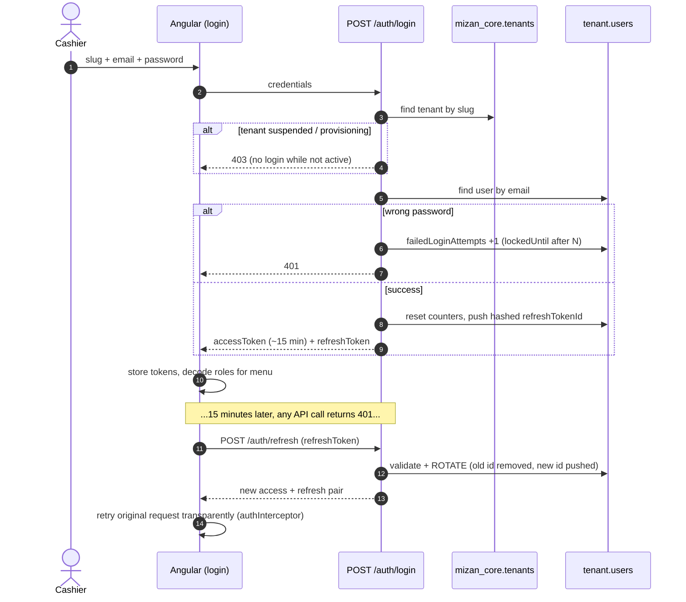

### 8.2 Online checkout — every write, in order

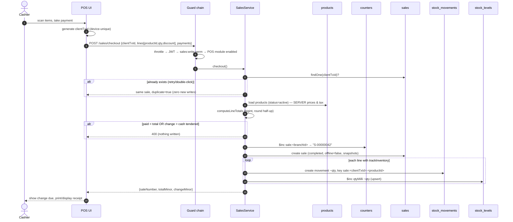

### 8.3 Offline sale — capture now, sync later

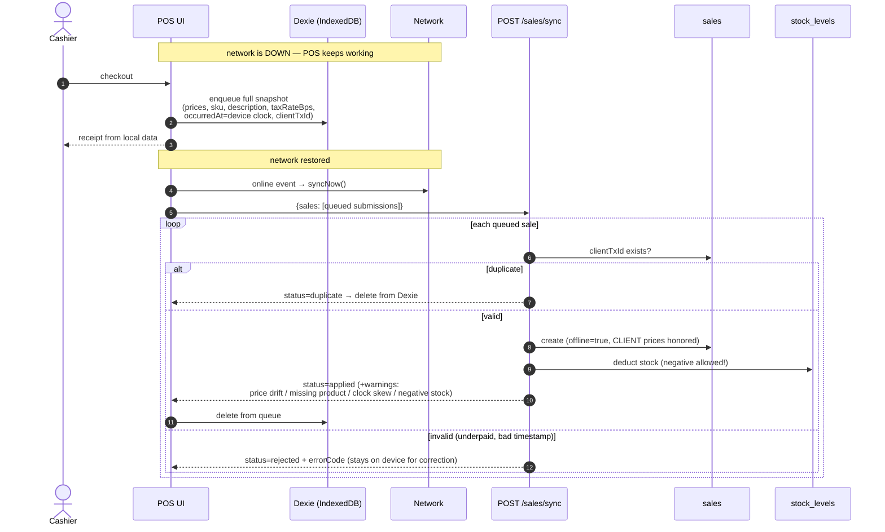

### 8.4 Refund — negative mirror document

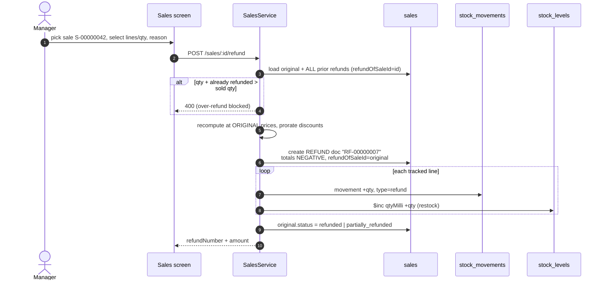

### 8.5 Purchase order → goods receipt

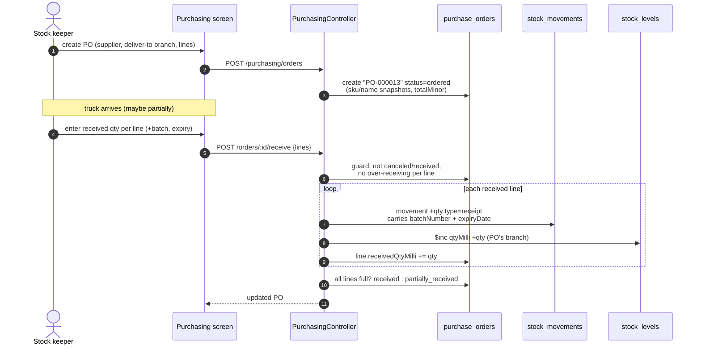

### 8.6 Lifecycles at a glance (state machines)

**Tenant**

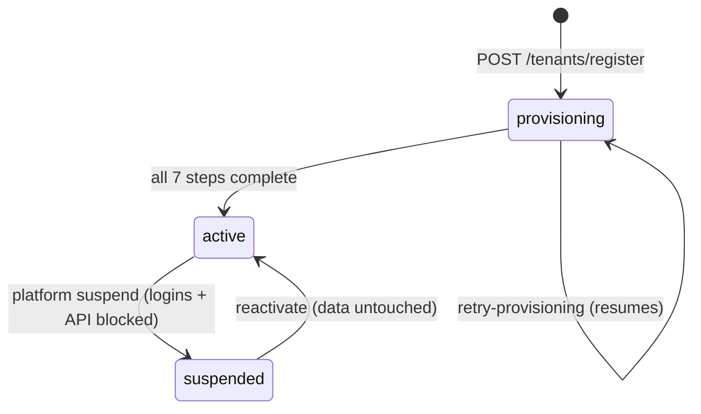

**Subscription → what the tenant can do**

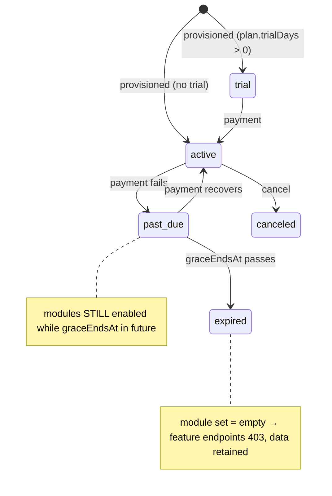

**Sale document**

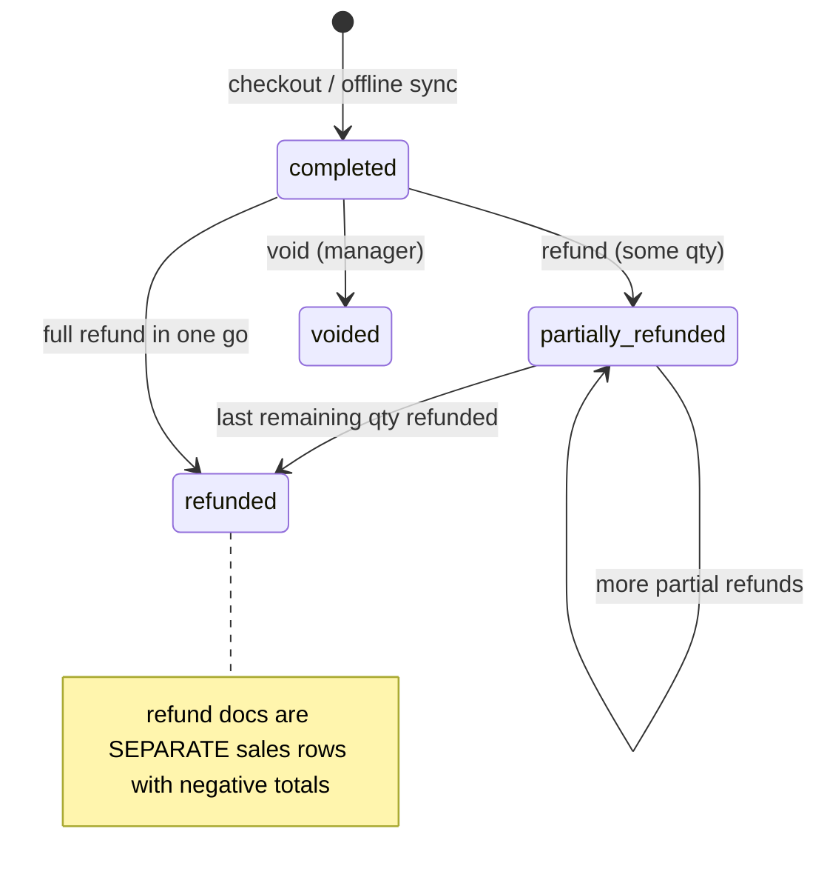

### 8.7 Master journey — one picture, whole product

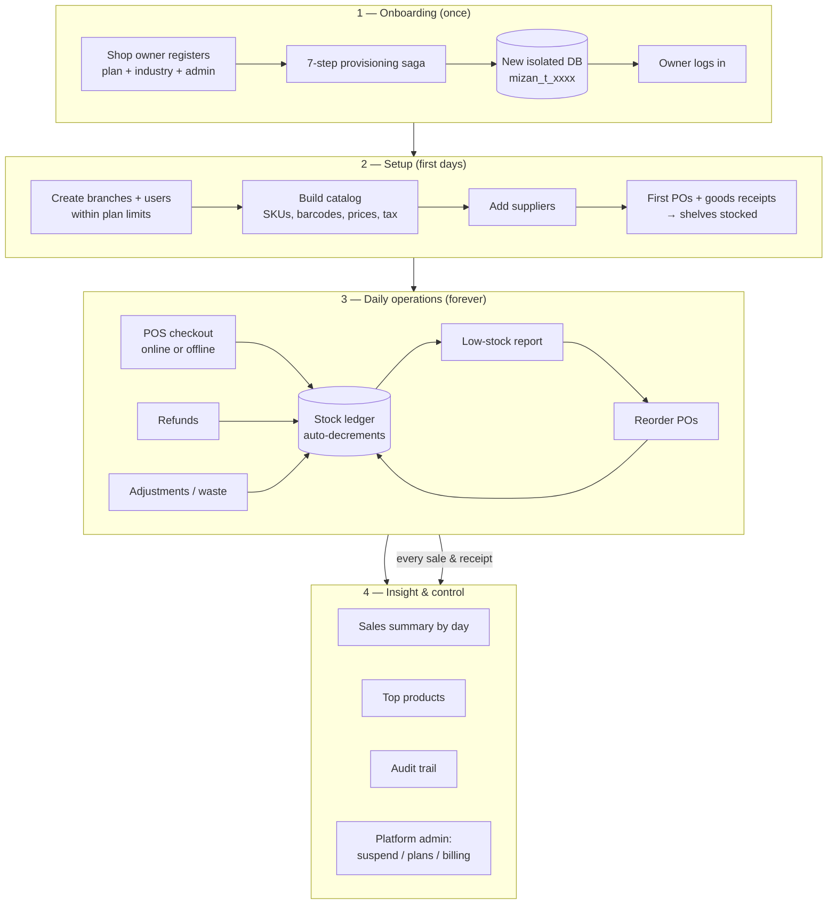

---

## 9. Where to read the code for each topic

| Topic | File |
|---|---|
| Core (control-plane) schemas | apps/backend/src/database/core.schemas.ts |
| Tenant schemas | apps/backend/src/database/tenant.schemas.ts |
| Tenant DB resolution / isolation | apps/backend/src/database/tenant-access.service.ts |
| Provisioning saga | apps/backend/src/tenants/tenants.service.ts |
| Checkout / offline sync / refund engine | apps/backend/src/sales/sales.service.ts |
| Stock ledger engine | apps/backend/src/inventory/inventory.service.ts |
| Entitlements (plan → modules, caching) | apps/backend/src/subscriptions/entitlements.service.ts |
| Money & quantity math | libs/shared/src/money.ts |
| Roles → permissions | libs/shared/src/security.ts |
| Offline queue (client) | apps/frontend/src/app/core/offline-queue.service.ts |
| Guard chain wiring | apps/backend/src/app.module.ts, apps/backend/src/main.ts |
